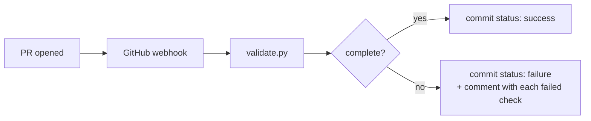

# DSH Conformance Results

**Public submission repository for DSH plugin conformance results.**
**DSH 插件一致性結果的公開提交倉庫。**

[中文说明见下方](#中文说明) · Standard: [DSHIO/T 10](https://dshio.org/10/) · Format: [DSHIO/T 37](https://dshio.org/37/)

---

## What this repository is

This is where **conformance results for DSH plugins** are published, in the open.

It exists because a test result you cannot audit is worth very little. Here, every result
is a set of files you can read, check, and re-run yourself.

**This repository does not certify anything.** It stores submissions. A validator checks
that each submission is complete and well-formed — **it does not check that the result is
true**. Whoever submitted a result is responsible for it.

---

## Who can submit

**Anyone who meets the conditions in [DSHIO/T 36](https://dshio.org/36/).**

There is no application, no approval, no fee. You need:

1. Run the tests per [DSHIO/T 20](https://dshio.org/20/) (stages T0–T4)
2. Use the test conditions in [DSHIO/T 21](https://dshio.org/21/)
3. Keep the raw output
4. Run twice and get the same verdict
5. Declare any conflicts of interest

Then open a pull request. See [SUBMISSION-FORMAT.md](SUBMISSION-FORMAT.md).

---

## Repository layout

```
testers/
  <tester-slug>/
    TESTER.yaml          Who you are, what you cover, conflicts of interest

results/
  v<baseline-dsh-version>/
    <plugin-slug>/
      README.md          How to reproduce
      result.json        Full raw output (not a summary)
      TESTER.yaml        Copy of the tester's declaration

snapshots/
  <date>.json            Pointers to bulk exports of the tester's own results

validate.py              The validator (runs in CI on every PR)
```

---

## Snapshot

A bulk export of one tester's results is published as a **snapshot** — a pointer, not a
conformance result.

| | |
|---|---|
| Latest | [`snapshots/2026-11-08.json`](snapshots/2026-11-08.json) |
| Archive | [snapshot-20261108.jsonl.gz](https://deepseekbase.com/dsh-conformance/snapshot-20261108.jsonl.gz) |
| Records | 3,134 with an environment fingerprint |
| sha256 | `0c1f3257...` (see the snapshot file) |

A snapshot is useful for analysis. It is **not** a substitute for individual verifiable
submissions — each result still needs its own directory under `results/`.

Records without an environment fingerprint are excluded, because without one they are
not comparable under DSHIO/T 21.

---

## What the validator checks

It is deliberately mechanical. It looks at whether the submission is complete and
internally consistent — not whether the plugin actually works.

| # | Check |
|---|---|
| 1 | Directory is `results/v<version>/<slug>/` |
| 2 | All three files present |
| 3 | `result.json` is valid JSON |
| 4 | `result.json` has an environment fingerprint matching DSHIO/T 21 |
| 5 | All five stages present (static, install, list, config, boot) |
| 6 | No failed stage |
| 7 | Repeat run recorded and consistent |
| 8 | `TESTER.yaml` has all required fields |
| 9 | Conflict-of-interest section filled in |
| 10 | `README.md` explains how to reproduce |
| 11 | Baseline version is a currently supported one |
| 12 | Only the required files are in the directory |

If any check fails the PR gets the `not-verifiable` label with a per-check explanation.

---

## How validation runs

A pull request is validated **automatically** by a webhook, not by GitHub Actions.

| | |
|---|---|
| Trigger | `pull_request` (opened / synchronize / reopened) |
| Endpoint | `https://deepseekbase.com/api/conformance/hook` |
| What it does | fetches the diff, runs `validate.py` on the changed directories, posts the result |
| Where you see it | a commit status **`dsh-conformance/validate`** on the PR, plus a comment with the detail |



### Why not GitHub Actions

Pushing a file under `.github/workflows/` requires a token with the `workflow` scope,
which is a manual step. A webhook plus the commit-status API only needs the `repo` scope,
which the repository already has — so the whole chain can be set up programmatically.

For contributors the experience is identical: you open a PR, a check appears, you read
the result. Nothing to install, nothing to configure on your side.

> `ci/validate-workflow.yml` is kept as an alternative for anyone who prefers a
> GitHub Actions runner. It is not active by default.

---

## What a passing submission means

It means: **the files are complete, consistent, and reproducible in principle.**

It does **not** mean:

- DSHIO tested anything
- DSHIO vouches for the result
- The plugin is certified
- The plugin is safe

**Certification does not exist yet.** DSHIO/T 32 is still not in effect. Any claim of
"DSHIO certified" is false.

---

## If you find a result you believe is wrong

Open an issue with evidence that can be reproduced. We will:

1. Record the dispute
2. If the evidence holds, mark the submission `disputed`
3. Not arbitrate between you and the tester — we have no authority for that

---

## Why this model

It follows how the Kubernetes conformance program works: the vendor runs the tests,
publishes the raw log, and a bot checks that the log is complete. Trust comes from the
log being public and re-runnable, not from a central authority vouching for it.

Full background: [research note on dshio.org](https://dshio.org/37/).

---

## License

- Submission data: [CC BY 4.0](https://creativecommons.org/licenses/by/4.0/)
- Validator code: MIT

---

## Independence

DSHIO is an independent third-party standards body with no affiliation to DeepSeek.
`deepseekbase.com` is one of the testing organizations that submits results here;
it is not the owner of this repository's rules.

---

# 中文说明

**DSH 插件一致性結果的公開提交倉庫。**

## 這是什麼

這裡公開存放 **DSH 插件的一致性結果**。

存在的理由：一份你無法審計的測試結果，價值很低。在這裡，每份結果都是你**可以自己讀、
自己核對、自己重跑**的一組文件。

**本倉庫不做任何認證。** 它只存放提交。驗證器檢查的是「提交是否完整、格式是否正確」，
**不檢查「結果是否真實」**。誰提交的，誰負責。

## 誰能提交

**任何滿足 [DSHIO/T 36](https://dshio.org/36/) 條件的機構或個人。**

不需要申請、不需要審批、不需要付費。你只需要：

1. 按 [DSHIO/T 20](https://dshio.org/20/) 執行 T0–T4
2. 使用 [DSHIO/T 21](https://dshio.org/21/) 的測試條件
3. 保留原始輸出
4. 跑兩次，結論一致
5. 聲明利益衝突

然後提 PR。格式見 [SUBMISSION-FORMAT.md](SUBMISSION-FORMAT.md)。

## 目錄結構

```
testers/
  <機構slug>/
    TESTER.yaml          你是誰、覆蓋什麼、利益衝突

results/
  v<基準DSH版本>/
    <插件slug>/
      README.md          如何複現
      result.json        完整原始輸出（不是總結）
      TESTER.yaml        機構聲明副本

snapshots/
  <日期>.json            批量結果導出的指針
```

## 驗證器檢查什麼

刻意做成機械式：只查「提交是否完整、內部是否自洽」，**不查插件是否真的好用**。

| # | 檢查 |
|---|---|
| 1 | 目錄是否為 `results/v<version>/<slug>/` |
| 2 | 三個文件是否齊全 |
| 3 | `result.json` 是否合法 JSON |
| 4 | 環境指紋是否符合 DSHIO/T 21 |
| 5 | 五個階段是否齊全（static/install/list/config/boot）|
| 6 | 有沒有失敗階段 |
| 7 | 是否記錄了重複運行且一致 |
| 8 | `TESTER.yaml` 必填欄位是否齊全 |
| 9 | 利益衝突是否已填寫 |
| 10 | `README.md` 是否說明如何複現 |
| 11 | 基準版本是否在當前支持範圍 |
| 12 | 目錄裡是否只有必需文件 |

任何一項不過，PR 會被打上 `not-verifiable` 標籤並逐項說明原因。

## 通過意味著什麼

意味著：**文件完整、內部自洽、原理上可複現。**

**不**意味著：

- DSHIO 測過這個插件
- DSHIO 為這個結果背書
- 插件獲得了認證
- 插件是安全的

**認證目前不存在。** DSHIO/T 32 仍未啟用。任何聲稱獲得 DSHIO 認證的表述均為虛假。

## 如果你認為某份結果有問題

帶上可複現的證據開 issue。我們會：

1. 記錄爭議
2. 證據充分則在提交上標 `disputed`
3. **不在你和檢測機構之間仲裁** —— 我們沒有這個權力

## 為什麼用這個模式

參考 Kubernetes 一致性認證的做法：廠商自己跑測試、公開原始日誌、Bot 檢查日誌是否完整。

**信任來自日誌公開且可重跑，不來自某個中心機構的背書。**
<!-- webhook push test 1794110249 -->
